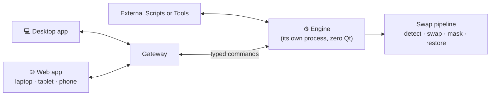
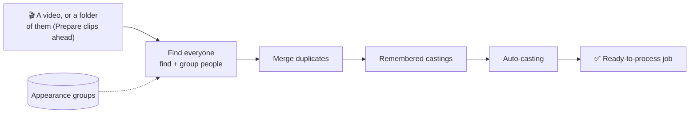

  <picture>
    
  </picture>

<h1 align="center"><b>An end-to-end rebuild of VisoMaster.</b></h1>

(Pre-Release Notes.)

  
  
  
  

  <a href="#-background">Background</a> ·
  <a href="#-what-omniswap-does-differently">What's Different</a> ·
  <a href="#-speed-and-stability">Speed</a> ·
  <a href="#-a-new-user-experience-built-from-scratch">New UX</a> ·
  <a href="#-unique-features">Unique Features</a> ·
  <a href="#-other-changes">Other Changes</a>

> [!NOTE]
> OmniSwap Studio is not currently available to the public. It's been in development for over a year, and will be releasing very soon. Everything described below is subject to change.

## 🖼️ UI Previews and Interactive Demo

  

  

## 📖 Background

OmniSwap Studio is a full rewrite of VisoMaster using the most capable, optimized technical foundations and standards available. It **completely replaces ~90%+ of the original VisoMaster code**, overhauling all core features and capabilities to achieve drastic improvements end-to-end.

## 🧩 Redesigned Core Architecture 

1. **<ins>Separated the entire processing pipeline from the UI.</ins>** Everything that actually swaps faces now exists in a dedicated engine with **zero Qt imports**. It doesn't know a UI window even exists. It can handle a whole job from start to finish at the command line (images, videos + segments, HDR, VR180, denoiser, any number of jobs), and its output is **bit-identical** to what the original VisoMaster window records. Every setting, job, face/source, and the new Auto Detect system are all engine commands, not just button presses.
2. **<ins>Moved that engine into its own process.</ins>** The window process doesn't load a single model or touch CUDA at all, so heavy work can never freeze it.
3. **<ins>A typed, language-neutral API.</ins>** OmniSwap's new UI built from scratch, any external scripts, or an AI agent can drive it in whatever language, with nothing to break when the UI changes.

## ⚡ Speed and Stability

| | VisoMaster | OmniSwap Studio |
|---|:---:|:---:|
| Worst UI freeze | ~38 s | **~0.17 s** |
| Cached TensorRT model load | ~40 s each | **0.1–3.3 s** |
| Frame processing (720p test job) | ~13.6 fps | **15-22 fps*** |

*This result will become more definitive before release

- **<ins>Fixed the biggest bottleneck.</ins>** The GPU used to sit idle almost half the time waiting on Python to hand it work. Now it stays busy at all times, giving a verifiable 5%-30% speed increase for all frame processing compared to both VisoMaster and VisoMaster-Fusion.
- **<ins>UI freezing effectively eliminated.</ins>** No more modal "Loading…" popups, and heavy work like building embeddings runs in the background.
- **<ins>Cached models load directly.</ins>** OmniSwap always loads TensorRT models straight from the cached engine.
- **<ins>Crash recovery.</ins>** If the engine ever crashes (0 crashes in all of OmniSwap's testing), the UI window stays open, tells you, restarts it, and carries on.
- **<ins>No unswapped flashes.</ins>** A frame that fails never flashes the original, unswapped face into your recording.

## ✅ Verification

Every change to the swap pipeline is checked against real recordings, frame by frame, and strictly bit for bit. That's **52 checks** covering 26 setting variations plus HDR, VR180, video + segments, images, and the denoiser, in addition to OmniSwap's **1,000+ automated tests**, all of which pass.

## 💻 A New User Experience, Built From Scratch

OmniSwap Studio replaces VisoMaster's Qt window with a completely new interface. It is one app that runs two ways: as a **desktop app** and as a **web app** in any browser, on a laptop, tablet or phone. Both drive the same engine, so you can use either one or both at once on the same job. An edit made in one shows up on the next frame in the other.

- **<ins>Plain-language controls.</ins>** More than 300 raw settings are folded into a short set of controls whose effect you can see: Face model, Likeness, Detail, Skin texture, Color match, Edges, Face obstructions, Keep original, Expression and more <i>(these will likely change before release)</i>. Every raw setting is still reachable.
- **<ins>See exactly what changed.</ins>** Result, Before, Split and Mask views. Hold <kbd>B</kbd> to see the original footage, or hold a control's eye button to see the picture without that one control.
- **<ins>A real timeline.</ins>** Thumbnails along the ruler, change points to vary a person's look over time, and a Problems track that marks frames likely to render badly.
- **<ins>Cast and library.</ins>** The people in each shot sit in a cast bar. **Find everyone** runs Auto Detect, groups each person and casts faces you used before. New faces are built straight from a folder of photos.
- **<ins>Render queue.</ins>** Queue several shots and render them one after another.
- **<ins>Use it from anywhere.</ins>** The web app can run the engine on its own, with no desktop window. Other devices on your network join with a six-digit pairing code, and a browser can follow the desktop app's playhead or look at its own frame.
- **<ins>Keyboard first, both themes.</ins>** Shortcuts for playback, people, change points and render ranges, a <kbd>Ctrl</kbd>+<kbd>K</kbd> search for any setting or action, and dedicated dark and light themes.
- **<ins>Never blocked.</ins>** No modal "Loading…" popups. The engine reports its progress and the app stays usable.

## ✨ Unique Features

- **<ins>Find everyone:</ins>** one button scans an entire video, finds every face, and groups them into people via intelligent temporal analysis, so a blurry background face or a one-frame misdetection doesn't become its own person.
- **<ins>Prepare clips ahead:https://www.reddit.com/</ins>** runs Find everyone, Remembered castings and Auto-casting on any number of videos, producing a ready-to-process job per video. *Point it at a folder of videos, walk away, and let OmniSwap handle the entire standard swapping workflow for you.*
- **<ins>Duplicate review:</ins>** when the same person gets split in two (different angle, lighting, haircut), Find everyone suggests merges with a confidence percentage, and you choose Merge or Keep apart.
- **<ins>Auto-casting:</ins>** with one click you can automatically cast every detected person by comparing their faces against your Faces library, then ranking them via face similarity and weighted demographics.
- **<ins>Appearance groups:</ins>** the memory behind all of it. Every person gets an identity made of several appearance groups (head turned vs. straight on, etc.), so faces are recognized as who they are, not just "the box that was here last frame." An optional strict mode (*Swap only confirmed people in play and render*) makes Play and Render swap only faces already tied to a known person, so a random passerby never gets swapped by accident.
- **<ins>Remembered castings:</ins>** when you cast a saved face on a detected person, OmniSwap can remember that, so they're automatically recognized and cast in any future video.
- **<ins>Demographics:</ins>** every detected face and every saved face gets gender, race, age range and hair color labels.
- **<ins>Deep-Learning:</ins>** optionally, new people who appear while a video is playing get their own face card automatically, and OmniSwap learns what each subject looks like at various angles, in certain lighting, at different distances, etc. The more frames processed with Deep-Learning enabled, the better OmniSwap recognizes them.
- **<ins>Require matching demographics:</ins>** Auto-casting can allow only faces that match on gender and race, with age and hair color either required or just preferred.
- **<ins>Managing remembered castings:</ins>** review, clear, export and import every remembered casting, and see which ones point to missing face files.
- **<ins>Identity details:</ins>** when paused, overlays from the Show menu show who each face is, the match confidence, and which saved faces it looks like.
- **<ins>Find everyone progress:</ins>** live progress, how many faces passed quality, and a score chart with a suggested threshold you can apply in one click.

## 🔧 Other Changes

- **<ins>Fixes:</ins>** recordings no longer lose their final frames, a failed frame no longer stalls playback or recording, and several settings that were silently ignored or loaded from the wrong place now work as intended.
- **<ins>New models:</ins>** YOLO-Face 11x and 12m detectors, FairFace demographics, a CLIP hair color classifier and the XSeg DFL HQ occlusion model.
- **<ins>HDR10 end to end:</ins>** 16-bit HDR decoding, x265 HDR metadata and NVENC quality tiers.
- **<ins>Modern stack for RTX 50-series GPUs:</ins>** Python 3.12, CUDA 13, PyTorch 2.14, ONNX Runtime 1.31 and TensorRT 10.16, with an environment validator and a GPU backend benchmark.
- **<ins>Lower memory:</ins>** a cap on frames in flight keeps 4K HDR recordings within memory, and idle memory with a 4K job loaded dropped from 6.2 GB to under 5 GB.
- **<ins>Cleaner code:</ins>** one logging system, no silently swallowed errors, dead code removed, one shared inference helper instead of 63 hand-written blocks, and a quality ratchet that keeps it that way.

> [!IMPORTANT]
> 🚧 **Not yet implemented, TBD:** webcam input, virtual camera output, and audio during live playback. The initial release focuses on the core swap pipeline, so these additional features will be reintegrated more optimally at a later point.
